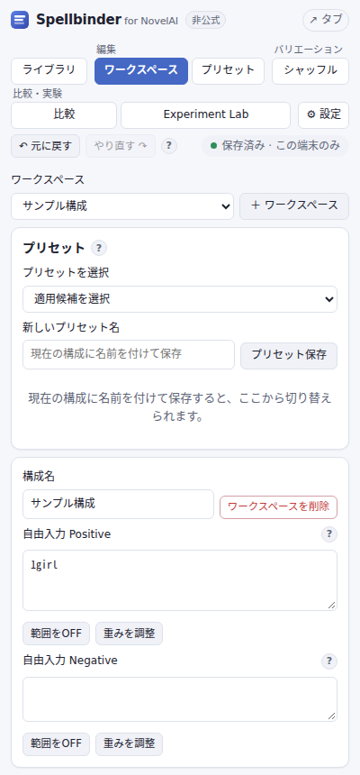
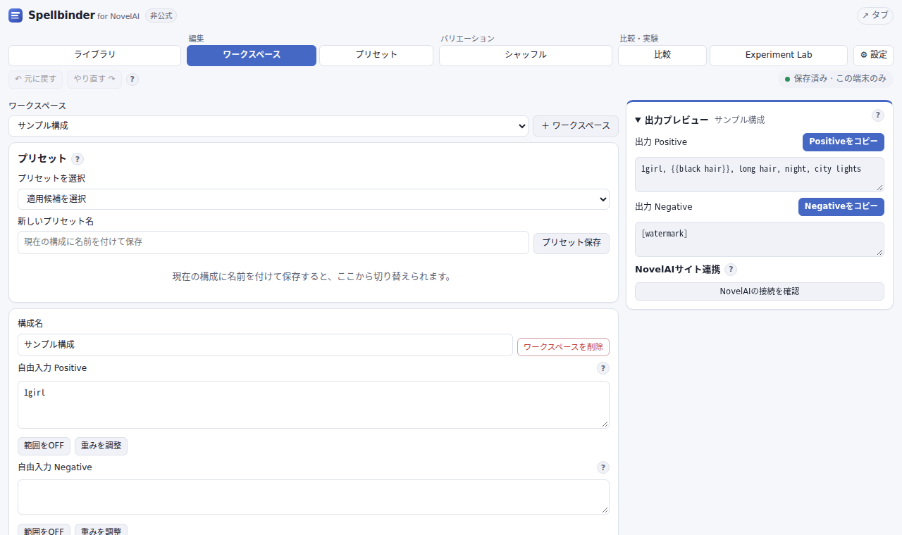

# Spellbinder for NovelAI (unofficial)

[日本語](README.md) | English

A Chrome extension for building NovelAI image-generation prompts ("spells") from reusable parts, varying them and comparing the results — a binder for your spells (formerly *NovelAI Prompt Workbench*). It runs in the browser's side panel and keeps all data inside your own Chrome profile.

> **Unofficial.** Not affiliated with NovelAI (Anlatan Inc.). It never generates images and never writes to NovelAI pages: you copy the prompt and paste it into NovelAI. Beta (0.x). The user interface is in Japanese; Experiment Lab can be switched to English.

## What it does

- **Library** — save tags and phrases as named parts with categories and tags; search them; a local tag dictionary with keyboard completion and spelling-variant hints
- **Workspace** — group parts, switch them on and off (one-of or any-of), and compose the Positive / Negative prompts; temporarily switch off part of a text
- **Presets** — save combinations, switch with one click, keep earlier versions and see tag-by-tag differences
- **Tag weights** — adjust a selected tag's weight with a slider (e.g. `1.4::blue eyes::`)
- **Shuffle** — keep a character's look and swap roles, poses, expressions and camera
- **A/B comparison & Experiment Lab** — line up images you generated by hand under different conditions; bulk-import PNGs, review (adopt / hold / reject), tag and filter them. NovelAI's PNG information is shown as *unverified candidates* that you adopt explicitly
- **Backups** — everything, including original images, in one ZIP; optional password encryption (AES-256-GCM); restore on another PC or Chrome profile

## What it does not do

- Write to NovelAI pages, press Generate, or generate automatically (deliberately disabled)
- Read NovelAI pages in languages other than English and Japanese; read prompts containing decorations or macros
- Support images other than PNG, or browsers other than Chrome

## Install

No Node.js needed. This is not the Chrome Web Store version, so there are no automatic updates.

1. Download the latest `spellbinder-for-novelai-<version>-chrome.zip` from [Releases](https://github.com/marc2825/spellbinder-for-novelai/releases) (not the "Source code" archives)
2. Choose a folder and extract the ZIP into it (`manifest.json` must be directly inside the folder)
3. Open `chrome://extensions` and turn on Developer mode
4. Click "Load unpacked" and select that folder
5. Open **Spellbinder for NovelAI (unofficial)** from the extensions menu (puzzle icon) to show the side panel

To update: save a complete backup (Settings → 完全バックアップをZIPで保存), extract the new ZIP into **the same folder**, and press the reload button in `chrome://extensions`. **Do not load it from a different folder** — Chrome identifies unpacked extensions by folder, so your data would not appear. Details (Japanese): [docs/install.md](docs/install.md).

## Data and privacy

- Data is saved automatically, only in this Chrome profile, and is **deleted when you remove the extension**. Save complete backups regularly.
- Backups are plain text unless you choose password encryption.
- Nothing is sent anywhere: no analytics, sync or ads. The only permission is `sidePanel`; the content script runs only on NovelAI's image page and only reads the prompt fields when you ask. See [PRIVACY.md](PRIVACY.md) (Japanese).

## NovelAI's Terms of Service

Use this extension in accordance with NovelAI's [Terms of Service](https://novelai.net/terms). **Where this extension's documentation and the terms differ, the terms always take precedence.** If NovelAI restricts tools like this, follow those restrictions. Compliance is not guaranteed ([notes](docs/security.md#novelai利用規約との関係), Japanese).

## Development

See [CONTRIBUTING.md](CONTRIBUTING.md), [docs/development.md](docs/development.md) and the [roadmap](ROADMAP.md) (Japanese). Security issues: report privately via [SECURITY.md](SECURITY.md).

## License

[MIT License](LICENSE). Third-party notices: [THIRD_PARTY_NOTICES.txt](public/THIRD_PARTY_NOTICES.txt). The name "NovelAI" is used only to identify the service this tool works with and does not imply endorsement.
